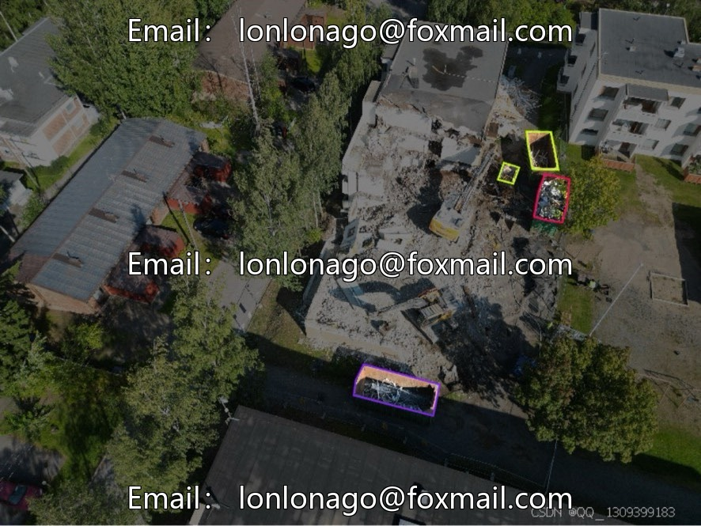
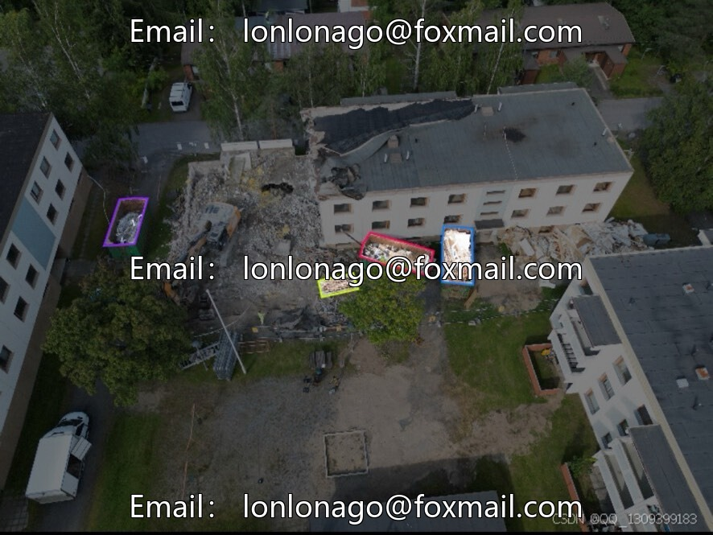

# DJI Aerial Photography Building Demolition Waste Detection Dataset | Issue 10042

## Body

DJI Drone POV-X Unmanned Aerial Vehicles Building Demolition Waste Target Detection Dataset | Issue 10042
A multi-category YOLO dataset for intelligent recognition of construction waste at demolition sites, using multiple DJI drones to capture high-definition real-world footage suitable for environmental protection and intelligent building inspection scenarios.
I. Basic Collection and Scale
1. Total number of images: 2,204, divided into 22 sub-datasets internally.
2. Collection equipment: DJI Mini 3 Pro, Mavic 2 Pro, Phantom 4 Pro V2, several DJI models to avoid model bias due to single device usage.
3. Focus on various types of waste storage containers in the shots, eliminating any empty or invalid frames, ensuring targeted training.
II. Complete Labeling of 12 Types of Construction Waste

Cover all common wastes on the demolition site, taking into account the condition of materials and containers.
Covering cloth, electronic waste, empty containers, gravel, insulation wool, metal scraps, mixed waste, plasterboard, polystyrene foam, roofing felt, wood waste, wood panel decoration materials
III. Dataset Splitting Plan

No official fixed split ratio, industry-standard 7:2:1 or 8:1:1 for training/validation/testing sets. Each subset can be independently split to adapt to various scenarios for training and generalization testing.
IV. Image Resolution Features
Relying on DJI's high-specification aerial photography camera, the original image resolution is 4800×3600, 5472×3648 and other high-resolution, texture details are clear, can distinguish the difference of various building waste materials.
Aerial photography offers a wide field of view, suitable for inspections on large-scale demolition sites.
V. Landing Application Scenarios
1. Drone remote inspection of construction sites, automatic statistics of waste distribution, optimize recycling and transportation plans.
2. Automated sorting of construction waste processing plants, replacing manual identification of various recyclable materials
3. Urban Management Environmental Protection Aerial Monitoring, Identifying and Investigating Illegal Open-Air Stacking and Discarding Practices

4. Environmental Project Effect Assessment, Calculating the Recycling Rate of Construction Waste
5. Architectural Industry Data Analysis, Aiding in the Development of Green Construction and Low-Carbon Demolition Plans
Virtual materials are non-refundable once sold.
Interested friends, click "I want it" now!

## Images

## Payment

Here is a pay link on Stripe ( https://buy.stripe.com/3cs8yP7sY87d0vu9AB ). Please contact me lonlonago@foxmail.com after funding $89, and I will send you a complete data files , thank you!

